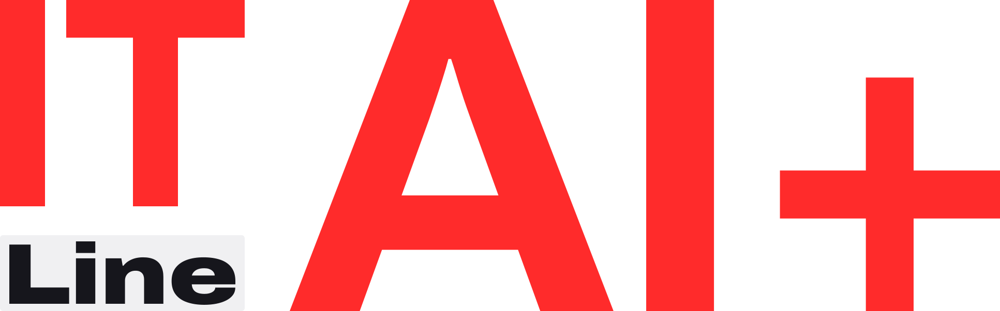
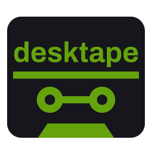

<p align="center">
  <picture>
    <source media="(prefers-color-scheme: dark)" srcset="site/brand/itline-aiplus-lockup.svg">
    
  </picture>
  &nbsp;&nbsp;&nbsp;
  <picture>
    <source media="(prefers-color-scheme: dark)" srcset="site/brand/desktape-dark-256.png">
    
  </picture>
</p>

<p align="center"><b>AI+ desktape</b> · ITLine AI+ · ingyenes · MIT · <a href="https://www.itline.hu/ai-plus/desktape/">itline.hu/ai-plus/desktape</a></p>

# AI+ desktape

## Magyarul

**API nélküli asztali programok vezérlése.** A desktape Windowson vagy macOS-en úgy kezel egy programot, ahogy egy
ember tenné: kattint, gépel, fájlt nyit meg, és a végén érték szerint ellenőrzi, hogy bekerültek-e az adatok. A
lépéseket egy AI-asszisztens egyszer kitalálja és egy YAML-fájlba menti, ez a tape. Utána a futtatás már AI-modell
nélkül megy.

Mire jó:

1. **Programvezérlés, ez a fő felhasználás.** Egy asszisztens elvégzi a valódi munkát egy olyan programban, amelynek
   nincs API-ja, például egy régebbi ügyviteli vagy készletkezelő programban: szállítólevelet visz fel, árlistát
   frissít egy beszállítói PDF-ből, havi fájlt importál. Te megmondod, mit csináljon, a desktape kattint, és minden
   lépés eredményét ellenőrzi, a végén a program táblázatát is visszaolvassa.
2. **Tesztelés.** Ugyanaz a tape gyors tesztként is lefut.
3. **Bemutatás.** Ugyanaz a tape lassan, feliratos képernyővideóként is lefut.

A desktape nem a Claude saját képernyővezérlése: a lejátszás a Windows és a macOS akadálymentesítési felületén
keresztül kattint, lépésről lépésre, ahogy a tape előírja.

Állapot: korai verzió. A tape formátuma és a parancsok még változhatnak.

### Mielőtt elkezded

**Két szerep, lehet egy gép is.** A **vezérlő gép** az, ahol a Claude-dal beszélsz, és ahol a desktape fut. A
**célgép** az, ahol a program fut, amit kezelni kell. Ha a program a saját gépeden van, a kettő ugyanaz (helyben),
és nem kell SSH. Ha másik gépen, a vezérlő gép SSH-n éri el: ott a vezérlő gép a kliens, a célgép a szerver.

| | Vezérlő gép (SSH-kliens) | Célgép (SSH-szerver) |
|---|---|---|
| Mi ez | ahol a Claude-dal beszélsz | ahol a kezelendő program fut |
| Claude és a desktape plugin | kell | nem kell (a beállításnál segít, ha van) |
| uv (hozza a Pythont) | kell | nem kell |
| SSH | kliens, a Windows 10+, a macOS és a Linux eleve tudja | SSH-szerver, csak a helyi hálózatról vagy VPN-ről |
| Cua Driver 0.34.1 | nem kell | kell, a felhasználó asztali munkamenetében |
| ffmpeg | nem kell | kell |
| Kulcs | a `desktape pair` itt készíti | a vezérlő gép kulcsa kerül rá |
| Futás közben | Windows célgépnél egy nyitott RDP-ablak felé | macOS-en a képernyő nem lehet zárolva |

Helyben, egy gépen, a két oszlop egy gépre kerül, SSH nélkül.

- **Claude, fizetős előfizetéssel.** A pluginokhoz Pro vagy magasabb Claude-előfizetés kell. A desktape-nek
  parancsokat kell futtatnia, ezért a **Claude Desktop Code fülén** vagy a **Claude Code**-ban működik. A sima Chat
  nem tud parancsot futtatni, a Cowork-öt még nem próbáltuk ki. Letöltés: [claude.ai/download](https://claude.ai/download)
  (Claude Desktop), a Claude Code telepítése: [code.claude.com/docs/en/setup](https://code.claude.com/docs/en/setup).
- **A vezérlő gép:** Windows, macOS vagy Linux. Egyetlen eszköz kell rá, a [uv](https://docs.astral.sh/uv/), ez hozza
  a Pythont és a többit. Ha hiányzik, a Claude megmondja a telepítő parancsát, és a jóváhagyásod után telepíti.
- **A célgép:** Windows 10 vagy 11, vagy macOS. Rá kerül a Cua Driver (rögzített verzió, ellenőrzött hash-sel),
  az ffmpeg (kötelező: a felvétel és a feliratok ezzel készülnek), és ha másik gépről vezérled, egy SSH-szerver,
  csak a helyi hálózatról vagy VPN-ről elérhetően.
- **Egyszer egy ember a célgépnél, rendszergazdai joggal:** az SSH-szerver telepítéséhez (Windows UAC), macOS-en
  a Cua Driver engedélyeihez a Rendszerbeállításokban. Ezt senki nem teheti meg helyetted, a Claude sem.
- **Futás közben:** Windowson nyitva kell lennie egy RDP-ablaknak a célgép felé, macOS-en a képernyő nem lehet
  zárolva.

### Telepítés

1. **A plugin, a vezérlő gépen.** Claude Desktopban: Customize › Plugins › Add › Add marketplace, ide írd be:
   `itlinekft/aiplus-plugins`, majd Sync, és az AI+ desktape kártyán Add. Claude Code-ban:
   `claude plugin marketplace add itlinekft/aiplus-plugins`, utána `claude plugin install aiplus-desktape@aiplus-plugins`.
2. **Kérdezd meg a Claude-ot (a Code fülön): „hogyan kezdjem?”** Lefuttatja a `desktape doctor` ellenőrzést, ami
   semmit nem telepít, csak megmondja, mi hiányzik és mivel pótolható. Minden letöltésnél megmondja a forrást, és csak
   a jóváhagyásod után telepít.
3. **Ha a program egy másik gépen fut,** azt a gépet egyszer be kell kötni (lent).

A desktape saját piactere is működik, ha az ITLine-é nem elérhető: `https://github.com/itlinekft/aiplus-desktape.git`.

### Új célgép bekötése

1. A vezérlő gépen: `desktape pair <név> --os windows` (Macnél `--os macos`). Ez a géphez külön kulcsot készít, és
   kiír egy **telepítő parancsot** meg egy kérést az új gép Claude-jának.
2. A telepítő parancsot másold be az új gépen: Windowson egy sima (nem rendszergazdai) PowerShell ablakba, Macen a
   Terminálba. Előbb megmutatja a tervet és a kulcs ujjlenyomatát, és csak egy `y` után kezd bele. A parancs ezt
   teszi:
   - letölti ennek a desktape-verziónak a telepítő scriptjét;
   - összeveti a vezérlő saját példányával (SHA-256), és csak egyezés esetén futtatja;
   - beállítja a gépet: SSH-szerver csak a helyi hálózatról vagy VPN-ről, a vezérlő kulcsa, a rögzített verziójú
     Cua Driver, ffmpeg.

   Windowson egyszer kér UAC-jóváhagyást. Macen a Remote Login bekapcsolása és a CuaDriver engedélyei a te
   kattintásaid, ezekhez a script megnyitja a megfelelő ablakot. A végén jelentést ír a gép címével.
   Ha az új gépen van Claude, a kérést neki is bemásolhatod: ő futtatja ugyanezt a parancsot, vagy lépésenként
   végigmegy a [beállítási útmutatón](docs/setup-target.md).
3. A vezérlőn: `desktape pair <név> --host <user>@<cím>`, utána `desktape pair <név> --check`.

A lépéseket kézzel is végig lehet csinálni: [Windows](docs/windows-setup.md),
[macOS](docs/macos-setup.md) (angolul).

Windowsra és macOS-re szól, Linux célgépként még nem támogatott. A telepítő scriptet 2026-11-18-án egy Windows 11-es
tesztgépen (virtuális gép) mértük, az útmutatót 2026-11-07-én egy Windows 10-es gépen; macOS-en még egyiket sem ([amit mértünk](docs/MEASURED.md)).

**Több gép:** egy Team vagy Enterprise Claude-szervezet adminja a szervezet beállításaiban minden tag gépére
kiteheti a plugint (az Anthropic leírása: [code.claude.com/docs/en/plugins/org](https://code.claude.com/docs/en/plugins/org));
desktape-pel ezt még nem mértük. Minden célgépet külön kell bekötni, saját kulccsal.

**Eltávolítás:** a plugin a Customize › Plugins alatt (vagy `claude plugin uninstall aiplus-desktape`), minden
célgépre `desktape unpair <név>`, utána a célgépen a [visszaállítás lépései](docs/setup-target.md#undo-everything).

Részletesen: [használati útmutató](docs/user-guide.md) (angolul), [hibaelhárítás](TROUBLESHOOTING.md) (magyarul és
angolul), [amit mértünk](docs/MEASURED.md).

## In English

**Control desktop programs that have no API.** An AI agent works out the clicks and typing once and keeps them
as a YAML **tape**; desktape then replays the tape, checking every step's outcome, with no model calls. Like
VHS, but for desktop GUIs: the same tape also runs as a test, or as a captioned video.

## What it is for

1. **Controlling a program: the main use.** An assistant does the real work in a desktop program that has no
   API, an accounting, inventory or any older Windows or macOS app:
   - it enters delivery notes;
   - it updates a price list from a supplier's PDF;
   - it imports a monthly file.
   The person says what to do ("take in these three delivery notes"). The assistant reads the documents and
   fills in a tape's inputs, and desktape does the clicking. It checks each step's outcome, and the end
   result by value, by reading the program's table back. Through the desktape plugin, Claude does this on
   the same computer, or on another one over SSH.
2. **Testing.** The same tape runs as a fast regression test of the program's UI.
3. **Showing.** The same tape runs slowly as a captioned screen recording, for a demo or a how-to video.

[Watch the 70-second demo](site/demo.mp4): recorded by `tapes/claude-desktop-demo.yaml`, 43 steps, no model
calls. The landing page is `site/`, published to GitHub Pages.

desktape drives a Windows or macOS desktop, from another machine over SSH or on the machine itself. An AI agent
looks at the screen cheaply, acts one step at a time, and keeps the steps that worked as a tape. From then on,
the tape runs without calling a model.

**No computer use needed.** desktape is not an AI controlling your computer. It does not use Claude's (or
any model's) computer use, and Claude Desktop's "Enable computer use" switch can stay off: the demo above
was recorded with it off. A replay clicks through the system's accessibility interface (UI Automation on Windows,
the accessibility API on macOS), step by step as the tape says, so
there is no model call, no per-app permission prompt, and no AI taking over the screen. A model is only
involved while an agent writes or repairs a tape, and even then it acts through desktape's `look` and
`act`, which read the screen as text first, not through the model's own computer use. How the two compare (plans,
which machine, permissions, cost): [`docs/related-work.md`](docs/related-work.md#desktape-and-claudes-own-computer-use).

Status: **early**. The tape format and the commands may still change.

## How it works

- **Driver:** [Cua Driver](https://github.com/trycua/cua) (MIT) runs on the target and exposes UI
  Automation over MCP. desktape reaches it with `ssh … cua-driver mcp`, so the target needs no inbound port
  beyond SSH.
- **Perception, cheapest first:** a compact list of labelled actionable elements and open dialogs
  (≈860 tokens for a busy screen, ≈120 for what changed after a click), filtered further with `--text` and
  `--grep`; then the target's built-in OCR; and only then an image. The full accessibility tree costs more
  than a screenshot, so it is never the default. Numbers: [`docs/spike-2026-10-23.md`](docs/spike-2026-10-23.md).
- **Tapes and maps:** a tape addresses elements by role and label, waits for them and checks them. Facts
  about an app (a label that carries a description, a tab that is a `TabItem`) go into a per-app **map**,
  so a tape can say `click: "@plugins.add_plugin"`.
- **No model in the runner:** a failed step writes a repair bundle, `runs/<stamp>/repair.md`, with the
  step, the map entry and the window's compact element list. The agent driving desktape fixes the map or
  the tape from it.
- **Safety:** a default-deny tool allowlist, an audit log of every call with secrets redacted, and the
  driver's telemetry, update check and script runner switched off. A video can cover the user's own
  content with redaction boxes, and then keeps no unredacted copy. A map can deny clicks on dangerous
  controls, and a replay stops on a dialog the tape did not plan.
- **One session per target:** `run`, `look` and `act` lock the target, so two agents cannot drive one
  desktop at once; the second waits, then stops naming the holder (`desktape.py lock` shows it). A project
  can book a machine for a time window (`desktape.py book --for 45m`), and `desktape.py panel` shows every
  machine's holder, bookings and live screen on a local web page. The panel's zoomed view also lets a
  person step in over a booking or a running command (Override): clicks and keys reach the machine while
  the booking and the run go on, and nothing is taken or released.
- **A step must do something:** a click or typed text that changed nothing fails as `no effect`, every
  driver call has a deadline, three failures in a row stop `act`, and `desktape.py status` (or
  `DESKTAPE_ALERT_CMD`) tells a watcher at once.

Rule of thumb: make deterministic only what repeats; the rest stays ad hoc with the model.

## Before you start

**Two roles, possibly one computer.** The **controller** is where you talk to Claude and where desktape runs. The
**target** is where the program to drive runs. When the program is on your own computer, the two are the same
(local) and no SSH is needed. When it is on another one, the controller reaches it over SSH: the controller is the SSH
client, the target the SSH server.

| | Controller (SSH client) | Target (SSH server) |
|---|---|---|
| What it is | where you talk to Claude | where the program to drive runs |
| Claude and the desktape plugin | yes | no (it helps with the setup when it is there) |
| uv (brings Python) | yes | no |
| SSH | the client, built into Windows 10+, macOS and Linux | an SSH server, reachable only from the local network or a VPN |
| Cua Driver 0.34.1 | no | yes, in the user's desktop session |
| ffmpeg | no | yes |
| Key | `desktape pair` makes it here | the controller's key goes here |
| During a run | an RDP window open to a Windows target | on macOS the screen stays unlocked |

Local, on one computer, both columns go on that computer, with no SSH.

- **Claude, on a paid plan.** Plugins need a Pro or higher Claude plan. desktape runs commands, so it works in
  **Claude Desktop's Code tab** or in **Claude Code**. Plain Chat cannot run commands; Cowork is not tested yet.
  Get Claude Desktop at [claude.ai/download](https://claude.ai/download), Claude Code at
  [code.claude.com/docs/en/setup](https://code.claude.com/docs/en/setup).
- **The controller:** Windows, macOS or Linux. The one tool it needs is [uv](https://docs.astral.sh/uv/), which brings
  Python and PyYAML (`uv run desktape.py`). When it is missing, Claude names its install command and runs it after
  your yes. Without uv: Python 3.9+ and `pip install --user -r requirements.txt`.
- **The target:** Windows 10 or 11, or macOS (tested on macOS 26.4, Apple Silicon). It gets Cua Driver 0.34.1 (pinned,
  checksum checked), an ffmpeg full build (required: the driver records video through it), and, when another
  computer drives it, an SSH server reachable only from the local network or a VPN.
- **Once, a person at the target with an administrator account:** for the SSH server (Windows UAC), and on macOS for
  Cua Driver's permissions in System Settings. Nobody can do this for you, Claude included.
- **During a run:** on Windows an RDP client stays connected and visible (Windows stops rendering a minimised or
  disconnected session; a headless keeper is `openspec/changes/headless-session`); on macOS the screen stays
  unlocked (macOS hides every window from Accessibility behind the lock screen).

Every install with its version, admin need and check: [`docs/install.md`](docs/install.md).

## Install

1. **The plugin, on the controller.** In Claude Desktop: **Customize › Plugins › Add › Add marketplace**, paste
   `itlinekft/aiplus-plugins`, **Sync**, then **Add** on the AI+ desktape card. In Claude Code:
   `claude plugin marketplace add itlinekft/aiplus-plugins`, then `claude plugin install aiplus-desktape@aiplus-plugins`.
2. **Ask Claude (in the Code tab) "how do I start?"** The `desktape-start` skill runs `desktape doctor`, which installs
   nothing: it names what this machine lacks and the one command that installs each piece (`winget`, `brew` or the
   tool's official script). Claude runs those one at a time, each approved in its permission prompt.
3. **When the program runs on another computer,** set that computer up once (below).

desktape's own marketplace works too: `https://github.com/itlinekft/aiplus-desktape.git`, then
`aiplus-desktape@aiplus-desktape`.

**A new target.** `desktape pair NAME --os windows` (or `--os macos`) makes a key for it and prints **one setup
command** for that machine. Paste it there, Windows into a normal (not administrator) PowerShell window, a Mac
into Terminal: it prints the plan and the key's fingerprint and starts only after a `y`. The command downloads this desktape release's setup script, runs it only
when its SHA-256 matches the controller's own copy, and sets the machine up: the SSH server limited to the local
network or VPN, the controller's key, the pinned Cua Driver, ffmpeg. Windows asks for one UAC approval; on a Mac,
Remote Login and the CuaDriver permissions stay the person's clicks. It ends with a report that gives the address
for `pair NAME --host user@address`, then `pair NAME --check`. `pair` also prints a request for the Claude on that
machine, which runs the same command or follows [`docs/setup-target.md`](docs/setup-target.md) step by step. By
hand: [`docs/windows-setup.md`](docs/windows-setup.md), [`docs/macos-setup.md`](docs/macos-setup.md).
The script was measured on a Windows 11 test VM on 2026-11-18, the guide on a Windows 10 PC on 2026-11-07; neither on
a Mac yet. Linux is not a target yet.

**Many machines.** A Team or Enterprise Claude organisation's admin can put the plugin on every member's machine
through managed settings ([code.claude.com/docs/en/plugins/org](https://code.claude.com/docs/en/plugins/org)); not
measured with desktape yet. Each target is paired on its own, with its own key.

**Uninstall:** remove the plugin in Customize › Plugins (or `claude plugin uninstall aiplus-desktape`), `desktape
unpair NAME` for each target, then the target's own steps: [`docs/setup-target.md`](docs/setup-target.md#undo-everything).

When something fails: [`TROUBLESHOOTING.md`](TROUBLESHOOTING.md). What has been measured: [`docs/MEASURED.md`](docs/MEASURED.md).

## Use

```bash
export DESKTAPE_HOST=user@windows-host                     # or --host; `local` on the Windows machine itself
python3 desktape.py targets                                # or name your machines: targets.example.yaml, --target NAME
python3 desktape.py --selftest                             # offline checks, no host needed
python3 desktape.py look --map claude-desktop-win          # the window's labelled actionable elements
python3 desktape.py look --map claude-desktop-win --new    # … only what changed since the last look
python3 desktape.py look --map claude-desktop-win --ocr    # … plus OCR lines with x,y
python3 desktape.py act 'click: "@plugins.add_plugin"' --append tapes/my-flow.yaml   # one step, kept if it passed
python3 desktape.py run tapes/claude-desktop-add-marketplace-dialog.yaml             # test mode
python3 desktape.py run tapes/claude-desktop-add-marketplace-dialog.yaml --mode video
python3 desktape.py tidy --keep Claude --minimize Terminal   # only the scene's programs on screen
python3 desktape.py record --until-file /tmp/take-done        # the target's whole screen, beside a run on another machine
python3 desktape.py pair box1 --host box1.local --user demo   # this machine's own key for a target: docs/pairing.md
python3 desktape.py pair box3 --os windows                    # a new target: a request for the Claude on it (docs/setup-target.md)
```

Authoring a tape: `look`, then `act` one step at a time with `--append`; a step is appended only if it
passed. Every command writes a run folder under `runs/` with `audit.jsonl`; `run` adds `summary.json`, and
in video mode the captioned `.mp4` and an `.srt`.

The sample tape opens Claude Desktop's "Add marketplace" dialog, fills in a URL and cancels; it changes
nothing. Measured on a Windows 11 target: 25/25 steps in 9.3 s (test) and 45.3 s (video, a pause after each caption), 0 model calls.

A walkthrough from install to a captioned video: [`docs/user-guide.md`](docs/user-guide.md). The tape and
map format: [`docs/tape-format.md`](docs/tape-format.md).

## Layout

- `desktape.py`: the runner and the CLI: `run`, `look`, `act`, `--selftest`.
- `maps/`: app maps: named selectors and app facts per app version.
- `tapes/`: flows: the marketplace-dialog sample, and `claude-desktop-tour.yaml`, a read-only tour of
  Claude Desktop's main screens that doubles as the map's regression test, and
  `claude-desktop-incognito-ask.yaml`, which asks one question in an incognito chat and waits for the answer,
  and `claude-desktop-demo.yaml`, which records the public demo with the user's content covered.
- `windows/`: scripts desktape copies to a Windows target (the OCR, run as a one-off interactive task).
- `macos/`: the pinned driver install for a Mac, and the Vision OCR helper desktape compiles there.
- `knowledge/`: what desktape knows about each operating system (file dialogs, permissions, the locked screen…),
  published and kept up to date; `desktape.py knowledge` prints it with your own notes on top.
- `docs/`: setup, the tape format, and measured results.
- `site/`: the landing page and the demo video (GitHub Pages, `.github/workflows/pages.yml`).
- `openspec/`: requirements and design decisions ([OpenSpec](https://github.com/Fission-AI/OpenSpec)).
- `client/`, `spike/`: the first measurements; kept for reference, not used by the runner.

## Roadmap

- Headless session keeper: FreeRDP on Xvfb, so a run needs no person's RDP window.
- desktape as a local MCP server, so Claude Desktop and Cowork can call `look`, `act` and `run`.
- Linux targets, on the same platform layer as Windows and macOS.

How desktape relates to VHS, Playwright, Cua Driver, OpenAdapt, Terminator and others:
[`docs/related-work.md`](docs/related-work.md).

## Contributing

See [`CONTRIBUTING.md`](CONTRIBUTING.md).

## License

MIT, Copyright (c) 2026 ITLine Kft.; see `LICENSE`. desktape drives [Cua Driver](https://github.com/trycua/cua) (MIT), which is installed
separately on the target and is not part of this repository.
