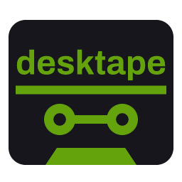

<p align="center">
  <picture>
    <source media="(prefers-color-scheme: dark)" srcset="site/brand/itline-aiplus-lockup.svg">
    
  </picture>
  &nbsp;&nbsp;&nbsp;
  <picture>
    <source media="(prefers-color-scheme: dark)" srcset="site/brand/desktape-dark-256.png">
    
  </picture>
</p>

<p align="center"><b>AI+ desktape</b> · ITLine AI+ · ingyenes · MIT</p>

# AI+ desktape

## Magyarul

**API nélküli asztali programok vezérlése.** A desktape Windowson vagy macOS-en úgy kezel egy programot, ahogy egy
ember tenné: kattint, gépel, fájlt nyit meg, és a végén érték szerint ellenőrzi, hogy bekerültek-e az adatok. A
lépéseket egy AI-asszisztens egyszer kitalálja és egy YAML-fájlba menti, ez a tape. Utána a futtatás már AI-modell
nélkül megy.

Mire jó:

1. **Programvezérlés, ez a fő felhasználás.** Egy asszisztens elvégzi a valódi munkát egy olyan programban, amelynek
   nincs API-ja, például egy régebbi ügyviteli vagy készletkezelő programban: szállítólevelet visz fel, árlistát
   frissít egy beszállítói PDF-ből, havi fájlt importál. Te megmondod, mit csináljon, a desktape kattint, és minden
   lépés eredményét ellenőrzi, a végén a program táblázatát is visszaolvassa.
2. **Tesztelés.** Ugyanaz a tape gyors tesztként is lefut.
3. **Bemutatás.** Ugyanaz a tape lassan, feliratos képernyővideóként is lefut.

A desktape nem a Claude saját képernyővezérlése: a lejátszás a Windows és a macOS akadálymentesítési felületén
keresztül kattint, lépésről lépésre, ahogy a tape előírja.

Állapot: korai verzió. A tape formátuma és a parancsok még változhatnak.

### Mi kell hozzá

- **A vezérelt gépen:** Windows 11 vagy macOS, a Cua Driver, SSH-belépés kulccsal, videóhoz ffmpeg.
- **Ahonnan vezérled:** Linux, Windows vagy macOS. A Pythont és a többi eszközt a `uv` hozza magával.
- **Futás közben:** Windowson nyitva kell lennie egy RDP-ablaknak, macOS-en a képernyő nem lehet zárolva.

### Telepítés

- **Claude Desktop:** Customize › Plugins › Add › Add marketplace, ide írd be: `itlinekft/aiplus-plugins`, majd
  add hozzá a desktape-et. A desktape saját piactere is működik: `https://github.com/itlinekft/aiplus-desktape.git`.
- **Claude Code:** `claude plugin marketplace add itlinekft/aiplus-plugins`, utána
  `claude plugin install desktape@aiplus-plugins`.

Első lépés: kérdezd meg a Claude-ot, „hogyan kezdjem?”. Megnézi, mi hiányzik a gépről, megmondja, honnan jön
minden letöltés, és csak a jóváhagyásod után telepít.

Részletesen: [használati útmutató](docs/user-guide.md) (angolul), [hibaelhárítás](TROUBLESHOOTING.md) (magyarul és
angolul), [amit mértünk](docs/MEASURED.md).

## In English

**Control desktop programs that have no API.** An AI agent works out the clicks and typing once and keeps them
as a YAML **tape**; desktape then replays the tape, checking every step's outcome, with no model calls. Like
VHS, but for desktop GUIs: the same tape also runs as a test, or as a captioned video.

## What it is for

1. **Controlling a program: the main use.** An assistant does the real work in a desktop program that has no
   API, an accounting, inventory or any older Windows or macOS app:
   - it enters delivery notes;
   - it updates a price list from a supplier's PDF;
   - it imports a monthly file.
   The person says what to do ("take in these three delivery notes"). The assistant reads the documents and
   fills in a tape's inputs, and desktape does the clicking. It checks each step's outcome, and the end
   result by value, by reading the program's table back. Through the desktape plugin, Claude does this on
   the same computer, or on another one over SSH.
2. **Testing.** The same tape runs as a fast regression test of the program's UI.
3. **Showing.** The same tape runs slowly as a captioned screen recording, for a demo or a how-to video.

[Watch the 70-second demo](site/demo.mp4): recorded by `tapes/claude-desktop-demo.yaml`, 43 steps, no model
calls. The landing page is `site/`, published to GitHub Pages.

desktape drives a Windows or macOS desktop, from another machine over SSH or on the machine itself. An AI agent
looks at the screen cheaply, acts one step at a time, and keeps the steps that worked as a tape. From then on,
the tape runs without calling a model.

**No computer use needed.** desktape is not an AI controlling your computer. It does not use Claude's (or
any model's) computer use, and Claude Desktop's "Enable computer use" switch can stay off: the demo above
was recorded with it off. A replay clicks through the system's accessibility interface (UI Automation on Windows,
the accessibility API on macOS), step by step as the tape says, so
there is no model call, no per-app permission prompt, and no AI taking over the screen. A model is only
involved while an agent writes or repairs a tape, and even then it acts through desktape's `look` and
`act`, which read the screen as text first, not through the model's own computer use. How the two compare (plans,
which machine, permissions, cost): [`docs/related-work.md`](docs/related-work.md#desktape-and-claudes-own-computer-use).

Status: **early**. The tape format and the commands may still change.

## How it works

- **Driver:** [Cua Driver](https://github.com/trycua/cua) (MIT) runs on the target and exposes UI
  Automation over MCP. desktape reaches it with `ssh … cua-driver mcp`, so the target needs no inbound port
  beyond SSH.
- **Perception, cheapest first:** a compact list of labelled actionable elements and open dialogs
  (≈860 tokens for a busy screen, ≈120 for what changed after a click), filtered further with `--text` and
  `--grep`; then the target's built-in OCR; and only then an image. The full accessibility tree costs more
  than a screenshot, so it is never the default. Numbers: [`docs/spike-2026-10-23.md`](docs/spike-2026-10-23.md).
- **Tapes and maps:** a tape addresses elements by role and label, waits for them and checks them. Facts
  about an app (a label that carries a description, a tab that is a `TabItem`) go into a per-app **map**,
  so a tape can say `click: "@plugins.add_plugin"`.
- **No model in the runner:** a failed step writes a repair bundle, `runs/<stamp>/repair.md`, with the
  step, the map entry and the window's compact element list. The agent driving desktape fixes the map or
  the tape from it.
- **Safety:** a default-deny tool allowlist, an audit log of every call with secrets redacted, and the
  driver's telemetry, update check and script runner switched off. A video can cover the user's own
  content with redaction boxes, and then keeps no unredacted copy. A map can deny clicks on dangerous
  controls, and a replay stops on a dialog the tape did not plan.
- **One session per target:** `run`, `look` and `act` lock the target, so two agents cannot drive one
  desktop at once; the second waits, then stops naming the holder (`desktape.py lock` shows it).
- **A step must do something:** a click or typed text that changed nothing fails as `no effect`, every
  driver call has a deadline, three failures in a row stop `act`, and `desktape.py status` (or
  `DESKTAPE_ALERT_CMD`) tells a watcher at once.

Rule of thumb: make deterministic only what repeats; the rest stays ad hoc with the model.

## Requirements

- **Controller (where desktape runs):** Linux, macOS, or Windows from the user's desktop session; Python 3.9+,
  PyYAML (`pip install -r requirements.txt`), and an OpenSSH client with key login to the target.
- **Target:** Windows (tested on Windows 11) with OpenSSH Server, Cua Driver 0.34.1 running in the user's interactive
  session, and an ffmpeg full build for video mode. Step by step: [`docs/windows-setup.md`](docs/windows-setup.md).
  Or macOS (tested on macOS 26.4, Apple Silicon) with Remote Login, Cua Driver 0.34.1 and its permissions
  granted once by a person, and `ffmpeg-full` for video mode: [`docs/macos-setup.md`](docs/macos-setup.md).
  Every install with its version, admin need and check: [`docs/install.md`](docs/install.md).
- An RDP client must stay connected and visible on a Windows target during a run, because Windows stops
  rendering a minimised or disconnected session. Holding the session headless from Linux is the next change
  (`openspec/changes/headless-session`).
- A macOS target needs no viewer window, but its screen must be unlocked during a run: macOS hides every
  window from Accessibility behind the lock screen.

## Install as a Claude plugin

In Claude Desktop: **Customize › Plugins › Add › Add marketplace**, paste `itlinekft/aiplus-plugins` (ITLine's
marketplace, which lists desktape) or `https://github.com/itlinekft/aiplus-desktape.git` (desktape's own), **Sync**, then
**Add desktape**. In Claude Code: `claude plugin marketplace add itlinekft/aiplus-plugins`, then
`claude plugin install desktape@aiplus-plugins`; or `/plugin marketplace add itlinekft/desktape`, then
`/plugin install desktape@desktape`.

Then ask Claude "how do I start?". The `desktape-start` skill runs `desktape.py doctor`, which names what this
machine still lacks and the one command that installs each piece (`winget`, `brew` or the tool's official
script); Claude runs those one at a time, each approved in its permission prompt. Nothing is installed by hand:
`uv run desktape.py` brings Python and PyYAML itself. The one exception is the Cua Driver on a Windows target, which
is installed in the desktop session with a pinned version ([`docs/windows-setup.md`](docs/windows-setup.md) §2).
When something fails: [`TROUBLESHOOTING.md`](TROUBLESHOOTING.md). What has been measured: [`docs/MEASURED.md`](docs/MEASURED.md).

## Use

```bash
export DESKTAPE_HOST=user@windows-host                     # or --host; `local` on the Windows machine itself
python3 desktape.py targets                                # or name your machines: targets.example.yaml, --target NAME
python3 desktape.py --selftest                             # offline checks, no host needed
python3 desktape.py look --map claude-desktop-win          # the window's labelled actionable elements
python3 desktape.py look --map claude-desktop-win --new    # … only what changed since the last look
python3 desktape.py look --map claude-desktop-win --ocr    # … plus OCR lines with x,y
python3 desktape.py act 'click: "@plugins.add_plugin"' --append tapes/my-flow.yaml   # one step, kept if it passed
python3 desktape.py run tapes/claude-desktop-add-marketplace-dialog.yaml             # test mode
python3 desktape.py run tapes/claude-desktop-add-marketplace-dialog.yaml --mode video
python3 desktape.py tidy --keep Claude --minimize Terminal   # only the scene's programs on screen
python3 desktape.py record --until-file /tmp/take-done        # the target's whole screen, beside a run on another machine
python3 desktape.py pair box1 --host box1.local --user demo   # this machine's own key for a target: docs/pairing.md
```

Authoring a tape: `look`, then `act` one step at a time with `--append`; a step is appended only if it
passed. Every command writes a run folder under `runs/` with `audit.jsonl`; `run` adds `summary.json`, and
in video mode the captioned `.mp4` and an `.srt`.

The sample tape opens Claude Desktop's "Add marketplace" dialog, fills in a URL and cancels; it changes
nothing. Measured on a Windows 11 target: 25/25 steps in 9.3 s (test) and 45.3 s (video, a pause after each caption), 0 model calls.

A walkthrough from install to a captioned video: [`docs/user-guide.md`](docs/user-guide.md). The tape and
map format: [`docs/tape-format.md`](docs/tape-format.md).

## Layout

- `desktape.py`: the runner and the CLI: `run`, `look`, `act`, `--selftest`.
- `maps/`: app maps: named selectors and app facts per app version.
- `tapes/`: flows: the marketplace-dialog sample, and `claude-desktop-tour.yaml`, a read-only tour of
  Claude Desktop's main screens that doubles as the map's regression test, and
  `claude-desktop-incognito-ask.yaml`, which asks one question in an incognito chat and waits for the answer,
  and `claude-desktop-demo.yaml`, which records the public demo with the user's content covered.
- `windows/`: scripts desktape copies to a Windows target (the OCR, run as a one-off interactive task).
- `macos/`: the pinned driver install for a Mac, and the Vision OCR helper desktape compiles there.
- `knowledge/`: what desktape knows about each operating system (file dialogs, permissions, the locked screen…),
  published and kept up to date; `desktape.py knowledge` prints it with your own notes on top.
- `docs/`: setup, the tape format, and measured results.
- `site/`: the landing page and the demo video (GitHub Pages, `.github/workflows/pages.yml`).
- `openspec/`: requirements and design decisions ([OpenSpec](https://github.com/Fission-AI/OpenSpec)).
- `client/`, `spike/`: the first measurements; kept for reference, not used by the runner.

## Roadmap

- Headless session keeper: FreeRDP on Xvfb, so a run needs no person's RDP window.
- desktape as a local MCP server, so Claude Desktop and Cowork can call `look`, `act` and `run`.
- Linux targets, on the same platform layer as Windows and macOS.

How desktape relates to VHS, Playwright, Cua Driver, OpenAdapt, Terminator and others:
[`docs/related-work.md`](docs/related-work.md).

## Contributing

See [`CONTRIBUTING.md`](CONTRIBUTING.md).

## License

MIT, Copyright (c) 2026 ITLine Kft.; see `LICENSE`. desktape drives [Cua Driver](https://github.com/trycua/cua) (MIT), which is installed
separately on the target and is not part of this repository.
